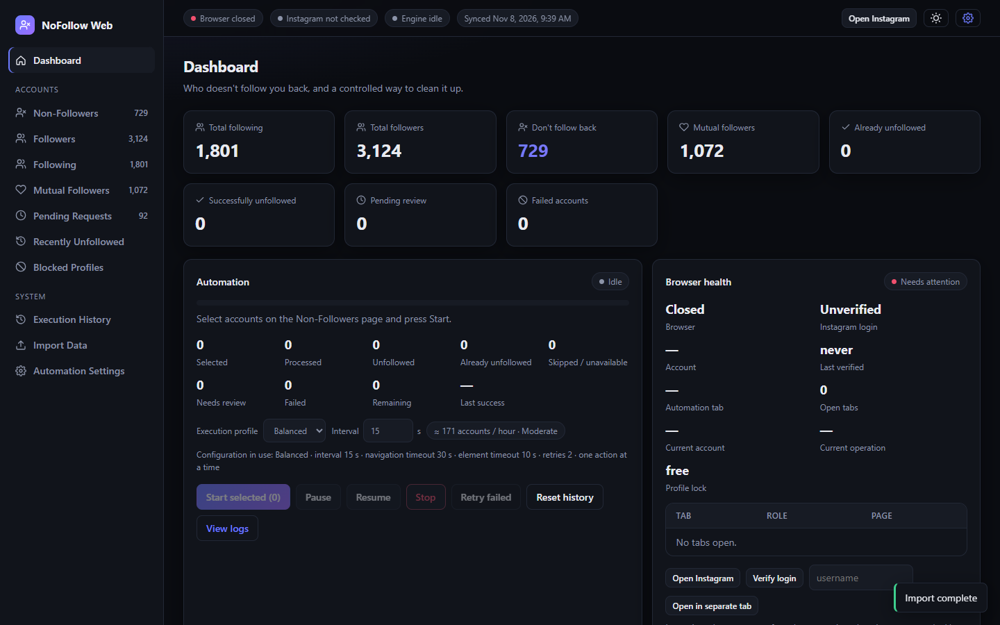
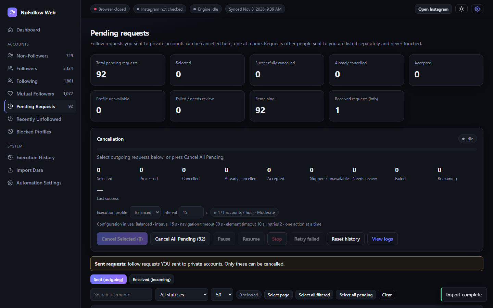
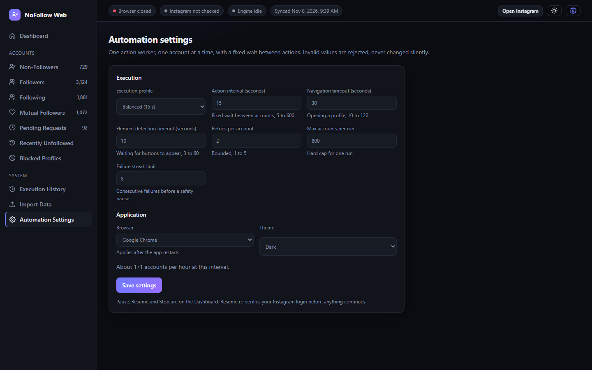

# NoFollow Web

Find the Instagram accounts you follow that don't follow you back, and cancel your own pending follow requests.
Everything runs on your PC, in your own logged-in browser window, one account at a time.

You use your own account and accept Instagram's rules. Bulk actions can cause action blocks or a ban. The engine
pauses on any Instagram warning; it never retries or works around a block, CAPTCHA, security check or login prompt.



## Install and run (Windows)

1. Install **Node.js 20 or newer** (https://nodejs.org) and **Google Chrome**. Check with `node -v`.
2. Copy the folder to the PC. Do **not** copy `node_modules`, `profile`, `data`, `logs` (the login lives in `profile`).
3. In the folder:
   ```
   npm install
   node unfollow.mjs
   ```
   or double-click `run.bat`. The dashboard opens at http://127.0.0.1:4173 (another port: `$env:PORT=4180; node unfollow.mjs`).
4. Stop with Ctrl+C in that window (or `POST /api/shutdown`). This closes the browser and releases the locks.

Only **one** NoFollow Web can run per data folder. A second start prints `NoFollow Web is already running on this machine`
and opens the existing dashboard instead. A lock left by a crash is recovered automatically.

If Chrome is not installed: `npx playwright-core install chromium` once. The app then uses Playwright Chromium with its
**own** profile folder (`profile-chromium`), so you log in once there; it never reuses the Chrome profile.

## First use

1. **Import Data**: choose the files from your Instagram export (`connections\followers_and_following`), JSON or HTML.
2. **Open Instagram** (top bar) and log in in that window. The login is saved in `profile/`.
3. Press **Verify login** (Browser health card). The app reports Instagram as logged in only after it has loaded the page and
   seen the logged-in navigation. A saved cookie alone is not accepted.
4. **Non-Followers**: search, filter, sort, select, **Start selected**, confirm.
5. **Pending Requests**: see below.

## Instagram export

Instagram > Settings > Accounts Center > Your information and permissions > Download your information > Some of your
information > **Followers and following** > Download to device. Set **Date range = All time** and format JSON or HTML.

Supported files: `followers_1`, `followers_2`..., `following`, `pending_follow_requests`, `recently_unfollowed_profiles`,
`blocked_profiles`, `profiles_you've_favorited`, `restricted_profiles`, `recent_follow_requests`,
`follow_requests_you've_received`, `removed_suggestions`. The import warns about missing or empty files, malformed records,
duplicates, and a followers file that starts much later than the following file (the "last year only" export).
Non-followers = following - followers. Pending and received requests are never counted as followers.

## Pending follow requests



* **Sent (outgoing)** = requests you sent that were not accepted. Only these can be cancelled.
* **Received (incoming)** = requests other people sent you. Read-only: no checkbox, no button, and the server rejects them.
* Buttons: **Cancel Selected**, **Cancel All Pending** (shows the exact count and what is excluded), a **Cancel request** button per
  row, Pause / Resume / Stop, Retry failed, live log and cancellation history. A summary of the run stays on the panel.
* Each request is re-checked on Instagram first: `Requested` > cancel; no request any more > `ALREADY_CANCELLED`;
  you follow them now > `ACCEPTED` (an accepted follow is **never** undone); page unavailable > `PROFILE_UNAVAILABLE`;
  unclear page > `NEEDS_REVIEW` with no click.
* Results are saved to `data/cancellation-state.json` after every account, kept apart from the unfollow history.

## Execution states

Engine: `IDLE > STARTING > CHECKING_SESSION > RUNNING`, waiting states `PAUSED`, `LOGIN_REQUIRED`, `RECOVERING`, `SAFETY_PAUSED`,
then `STOPPING`, `COMPLETED` or `FAILED`. Every change goes through a transition table. **No waiting state can return to RUNNING
without passing CHECKING_SESSION**, i.e. Resume re-verifies the Instagram login first and, if you are not logged in, stays in
`LOGIN_REQUIRED` with the reason. Before an account continues, its history and live page state are checked again.

Per account: `UNFOLLOWED`/`CANCELLED` (verified on the page), `ALREADY_UNFOLLOWED`/`ALREADY_CANCELLED`, `ACCEPTED`,
`PROFILE_UNAVAILABLE`, `SKIPPED`, `NEEDS_REVIEW`, `FAILED`, `ACTION_BLOCKED`, `PAUSED`, `PENDING`.

Errors are classified: `ELEMENT_NOT_FOUND`, `ELEMENT_NOT_VISIBLE`, `ELEMENT_NOT_ENABLED`, `NAVIGATION_TIMEOUT`,
`PROFILE_UNAVAILABLE`, `LOGIN_REQUIRED`, `SESSION_DISCONNECTED`, `RELATIONSHIP_AMBIGUOUS`, `INSTAGRAM_SECURITY_WARNING`.
Before any click the button must be present, the only visible match, and enabled. A page/layout problem goes to `NEEDS_REVIEW`
(screenshot saved), not into blind retries. Network problems are retried a bounded number of times, then `FAILED`.

## Browser and tabs

One persistent browser, owned by one session manager that validates it before every operation. A closed window or lost
connection puts the run in `RECOVERING`; Resume reopens the **same profile**, then verifies the login again. The app never
silently opens a different session. The browser stays open when a run ends.

You may open any number of **separate inspection tabs** (Browser health > "Open in separate tab", or open tabs yourself).
They are tracked by id, never duplicated, detected when closed, and never touched by a running job. The engine uses exactly one
automation tab and performs one action at a time.

## Automation settings



| Setting | Default | Range |
|---|---|---|
| Execution profile | Balanced | Safe 30 s, Balanced 15 s, Fast 8 s, or Custom |
| Action interval (fixed wait between accounts) | 15 s | 5-600 |
| Navigation timeout | 30 s | 10-120 |
| Element detection timeout | 10 s | 3-60 |
| Retries per account | 2 | 1-5 |
| Max accounts per run | 800 | 1-5000 |
| Failure streak limit (safety pause) | 8 | 2-50 |

Saved in `data/settings.json`; the panel shows the configuration in use; changes apply to the wait in progress. Invalid values are
**rejected with a message**, never clamped or changed silently. The interval is fixed (no randomisation), there is one worker and
no parallel tabs. Speed is never raised automatically. Rough rate: 3600 / (interval + about 6 s) accounts per hour.

## Logs, history, checkpoint

`data/execution-state.json` and `data/cancellation-state.json`: per-account result, attempts, previous status, last attempt, reason,
error code; written atomically (temp file + rename, `.bak` fallback); finished accounts are never repeated; a crash re-queues the
interrupted account. `logs/unfollow.log` and `logs/unfollow.jsonl` (structured). Execution History lists runs and downloads an error
report. Tokens and cookies are redacted from logs.

## Tests

```
npm test
```
101 tests: export parsing, relationships, checkpoint and settings, session detection, engine state machine, unfollow and
cancellation scenarios, real-browser tests against **mock Instagram pages** (all other traffic blocked), real-process tests for the
single-instance guard and clean shutdown, and a UI end-to-end run. Nothing in the tests touches instagram.com or a real account.

## Troubleshooting

| Problem | Fix |
|---|---|
| "browser profile is already open in another window" | A Chrome from an earlier run still holds `profile/`. Close those windows (or end them in Task Manager), then press Resume |
| `LOGIN_REQUIRED` after Resume | Log in in the Instagram window, then Resume again |
| `NEEDS_REVIEW` / `FAILED` rows | Open the screenshot in `logs/shots/`; the reason and error code are on the row (Inspect) |
| "already running on this machine" | Use the dashboard that opened; or end the old `node` process |
| Wrong non-follower count | Re-export with date range "All time" |

## Known limitations

* Instagram changes its pages often. The detection stops on `NEEDS_REVIEW` instead of guessing, but the real Instagram flow
  (especially the pending-request menu) has only been checked against mock pages, not automated against a live account here.
* The export has no account IDs, so accounts are matched by username; a renamed account shows as unavailable.
* Instagram may restrict bulk actions at any pace. The tool pauses; it cannot prevent a block.
* English plus Spanish, German, French and Portuguese button labels are recognised.
* The login check cannot read which account is logged in on every page layout; the account name is shown when found.

## Data protection

No passwords or cookies are read, stored or logged by this app; the login lives only in the browser profile. `profile/`, `data/`,
`logs/` are git-ignored. The server listens on 127.0.0.1 only and rejects requests from other sites.
