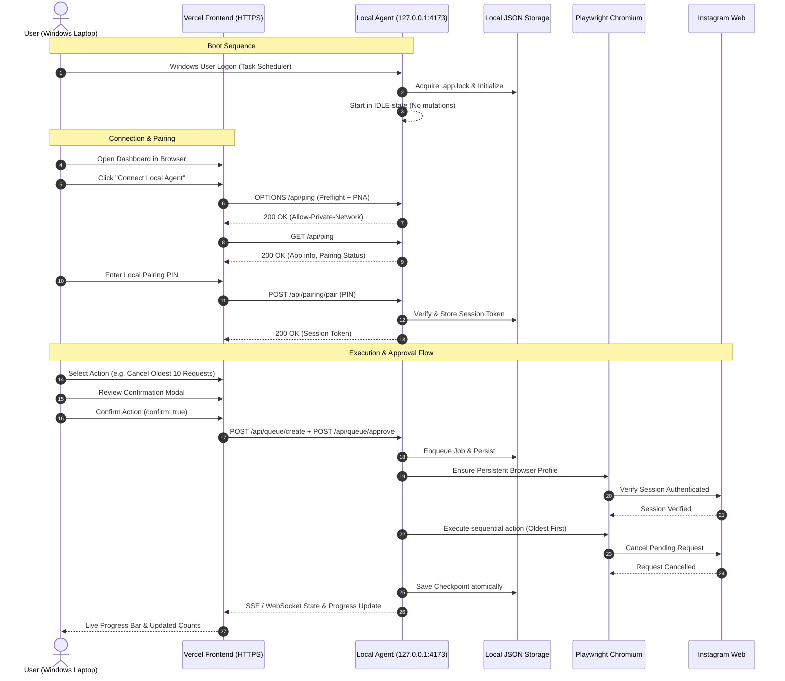

# Architecture Specification: NoFollow Web

**Model:** Vercel Static Frontend + Automatic Windows Local Playwright Agent  
**Host Binding:** `127.0.0.1:4173` (Loopback Only)  
**Data Storage:** Local JSON (Zero Cloud Backend)  

---

## 1. System Architecture Overview

```text
                        +---------------------------------------+
                        |             VERCEL HOSTING            |
                        |   - Static SPA Assets (HTML, CSS, JS) |
                        |   - No Cloud Functions / No Backend   |
                        |   - Content Delivery Network (CDN)    |
                        +-------------------+-------------------+
                                            |
                                            | (1) User accesses hosted UI
                                            v
                        +---------------------------------------+
                        |        USER'S BROWSER RUNTIME         |
                        |        (Same Windows Laptop)          |
                        |   - UI Rendering & Navigation         |
                        |   - User Approval Modals              |
                        |   - Pairing & Session Token (Storage) |
                        +-------------------+-------------------+
                                            |
                                            | (2) User-Initiated Connection
                                            |     Origin Check + Bearer Auth
                                            v
+---------------------------------------------------------------------------------+
|                          WINDOWS LOCAL AGENT (127.0.0.1:PORT)                   |
|                                                                                 |
|  +------------------------+  +------------------------+  +--------------------+ |
|  |     HTTP / SSE API     |  |    PAIRING SERVICE     |  | INSTANCE MUTEX     | |
|  | - Health (/api/ping)   |  | - Secure PIN / Tokens  |  | - Single Process   | |
|  | - Authenticated Routes |  | - Origin Allowlist     |  | - Stale Recovery   | |
|  +-----------+------------+  +------------------------+  +--------------------+ |
|              |                                                                  |
|              v                                                                  |
|  +----------------------------------------------------------------------------+ |
|  |                     CENTRAL JOB ORCHESTRATOR & QUEUE                       | |
|  |  - Single Mutating Worker Rule (Only 1 active execution)                   | |
|  |  - Explicit Approval Required for every batch / mutation                   | |
|  |  - State Machine: QUEUED -> AWAITING_APPROVAL -> APPROVED -> RUNNING       | |
|  +--------------------+-------------------------------+-----------------------+ |
|                       |                               |                         |
|                       v                               v                         v
|         +---------------------------+   +---------------------------+  +------+ |
|         |     PLAYWRIGHT ENGINE     |   |    CHECKPOINT & STATE     |  | LOGS | |
|         | - Dedicated Profile       |   | - execution-state.json    |  | Audit| |
|         | - Manual Login Detection  |   | - pending-request-state   |  | Run  | |
|         | - Rate-Limit Safeguards   |   | - central-queue-state     |  | Err  | |
|         +-------------+-------------+   +---------------------------+  +------+ |
+-----------------------|---------------------------------------------------------+
                        |
                        | (3) Direct Local Automation (Loopback)
                        v
         +-----------------------------+
         |     INSTAGRAM PLATFORM      |
         |  - Verification & Actions   |
         +-----------------------------+
```

---

## 2. Core Architectural Pillars

### Pillar 1: Total Data Sovereignty (Zero Cloud Backend)
- **Zero Cloud Relay / Database:** No Supabase, Firebase, Railway, or Render database is utilized.
- **Local Storage Exclusivity:** All Instagram relationship records, pending requests, execution checkpoints, browser cookies, and session profiles reside strictly on the local laptop in `data/`, `profile/`, and `logs/`.
- **Vercel Scope:** Vercel is strictly a static web host for the compiled SPA assets (`index.html`, `assets/`, `pages/`). No sensitive user data touches Vercel servers.

### Pillar 2: Local Agent Security & Access Control
- **Loopback Enforcement:** The local HTTP server binds strictly to IPv4 loopback (`127.0.0.1`). Binding to `0.0.0.0` or public interfaces is explicitly disallowed.
- **Pairing & Authorization Protocol:**
  1. The local agent maintains a secure pairing PIN in `data/pairing.json`.
  2. The Vercel frontend initiates a connection upon explicit user action ("Connect Local Agent").
  3. The user inputs the pairing PIN displayed on the local agent console/fallback dashboard.
  4. The local agent issues a cryptographically secure, revocable session token (`nf_sess_...`).
  5. Subsequent requests require `Authorization: Bearer <sessionToken>` and `X-NoFollow: 1`.
- **Origin Validation:** The local agent validates the `Origin` header against an allowlist containing `http://127.0.0.1:*`, `http://localhost:*`, and the authorized production Vercel domain.
- **No Arbitrary Execution:** The agent API exposes only domain-specific Instagram automation endpoints. Arbitrary shell execution or arbitrary filesystem traversal is strictly prevented.

### Pillar 3: Browser Mixed Content & Local Network Access (LNA) Mitigation
When accessing a loopback HTTP service (`http://127.0.0.1:4173`) from an HTTPS hosted origin (`https://*.vercel.app`), modern Chromium-based browsers enforce Mixed Content and Local Network Access restrictions.
The architecture addresses this with a dual-layer strategy:
1. **Explicit User-Initiated Connection with PNA Headers:**
   - Preflight `OPTIONS` requests respond with:
     ```http
     Access-Control-Allow-Origin: https://your-app.vercel.app
     Access-Control-Allow-Methods: GET, POST, OPTIONS
     Access-Control-Allow-Headers: Content-Type, Authorization, X-NoFollow
     Access-Control-Allow-Private-Network: true
     ```
2. **First-Class Local Fallback Dashboard:**
   - The local agent simultaneously serves the exact same static frontend at `http://127.0.0.1:4173`.
   - If the remote browser blocks loopback access, the Vercel UI immediately diagnoses the condition and provides a prominent **"Open Local Dashboard"** link.
   - The local dashboard runs entirely on loopback without cross-origin or mixed-content hurdles, guaranteeing 100% operational availability even if offline or untrusted.

### Pillar 4: Windows Automatic Startup
- **Logon Trigger:** A Windows Scheduled Task (`NoFollowWebAgent`) registered via PowerShell triggers automatically when the user logs into their Windows desktop.
- **Interactive Session:** Runs within the interactive user session, enabling Playwright to launch the visible Chromium browser window when manual login or inspection is requested.
- **Zero Auto-Mutation Invariant:**
  > **CRITICAL RULE:** The agent starts in `IDLE` state. It **NEVER** runs mutations, unfollows, or cancellations automatically on startup. Every batch action requires explicit user initiation and confirmation.

### Pillar 5: Central Job Orchestrator & Single Worker Rule
- **Unified Queue:** All operations (`unfollow`, `cancel`, `archive`, `story_highlights`) route through [`CentralJobOrchestrator`](file:///C:/Users/lenovo/Downloads/NoFollowWeb-portable/src/automation/central-orchestrator.mjs).
- **Single Mutating Worker:** At most ONE mutating job can run at a time to prevent race conditions and protect Instagram account health.
- **State Persistence:** Queue state is persisted in `data/central-queue-state.json`. Any interrupted jobs recover into `INTERRUPTED` or `RETRY_PENDING` without duplicate clicks.

---

## 3. Data Flow & Communication Lifecycle



---

## 4. API Endpoints Specification

### System & Health
- `GET /api/ping`: Public loopback health check returning PID, app name, and pairing status.
- `GET /api/health`: Detailed diagnostic state, browser connection, memory usage, uptime.
- `GET /api/events`: Server-Sent Events stream for real-time engine states, progress, logs, and account updates.

### Pairing & Security
- `GET /api/pairing/status`: Returns current pairing state and active sessions count.
- `POST /api/pairing/pair`: Exchanges one-time pairing PIN for an authenticated session token.
- `POST /api/pairing/revoke`: Revokes the current session token or all active sessions.

### Central Queue & Automation
- `GET /api/queue`: Retrieves all queued, running, paused, and historical jobs.
- `POST /api/queue/create`: Enqueues an action batch (requires user approval before execution).
- `POST /api/queue/approve`: Authorizes a pending job to transition to execution.
- `POST /api/queue/pause`: Pauses the active job worker.
- `POST /api/queue/resume`: Resumes a paused worker (re-verifies Instagram session first).
- `POST /api/queue/stop`: Stops the active job and marks remaining items queued.

### Accounts & Domain Modules
- `GET /api/accounts`: Paginated query interface supporting filtering, search, sorting (Oldest-First default for requests).
- `GET /api/cancel/preview`: Returns exact preview counts and oldest request metadata.
- `GET /api/history`: Comprehensive execution history with breakdown counts.
- `GET /api/logs`: Structured log entries with filtering by level.
- `POST /api/import/file`: Streams an Instagram export HTML/JSON file to the local parser.
- `POST /api/import/commit`: Commits imported export data into `data/import.json`.
- `POST /api/settings`: Updates automation parameters with strict range validation.
